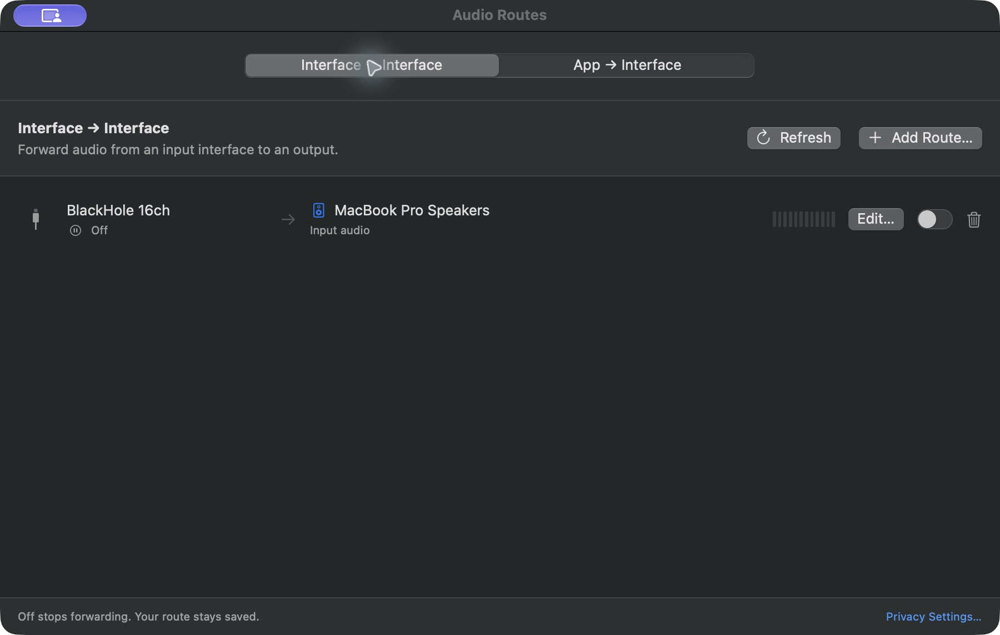
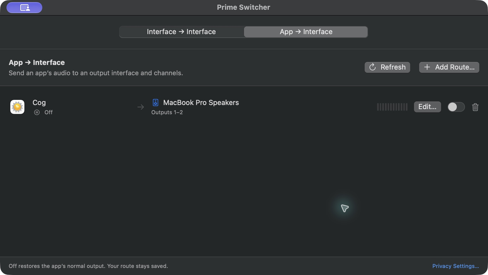

# Prime Switcher (macOS)

A native macOS audio routing window with two sections:

- **Interface → Interface:** save multiple input-to-output connections, each with its own switch. Choose mono, stereo, or a larger channel group, plus the first input and output channels.
- **App → Interface:** save routes from multiple applications to selected output devices and channels.

Connections, enabled/off state, and the selected section are saved in local app configuration (UserDefaults). Enabled routes resume on launch; unavailable applications or interfaces wait until they return. Switching an interface route off stops forwarding. Switching an app route off restores the application's normal audio output. Both keep their saved settings so they can be enabled again. New connections start off.

One **Prime Switcher.app** contains both sections and keeps both route lists in the same configuration. Prime Switcher uses its own configuration and app identity.

## Screenshots

### Interface → Interface

Save input-to-output connections, choose the channel count and input/output ranges, and switch each route on or off independently.



### App → Interface

Choose an app, output interface, and mono or stereo channels. The live meter shows when audio is passing.



## Run

From this directory:

```bash
make run             # Run Prime Switcher with both routing sections
```

Notes:
- You may need to grant microphone access to your terminal (System Settings -> Privacy & Security -> Microphone).
- Application routing requires macOS 14.2 or later and System Audio Recording permission. A packaged app receives the most reliable permission identity.
- Some device pairs may fail if the output device does not support the input device's sample rate and channel count.
- Prime Switcher keeps a list of **routes**. A route sends one application to one or two outputs of a device, for example Chrome to outputs 3–4 and Firefox to outputs 5–6 of BlackHole 16ch. Add one with **+** or ⌘N; double-click a route to edit it, press Delete to remove it, or use its switch to turn it off. Routes are saved, start when their application opens, and rebuild when it relaunches. An application can be in one route at a time; routes on the same outputs are mixed.
- Bluetooth, AirPlay, HDMI, and unusual multichannel layouts should be treated as experimental.

## App Bundle (Distribution)

Build the universal app for Apple silicon and Intel Macs:

```bash
./Scripts/make-app-bundle.sh
```

The script produces `dist/Prime Switcher.app`. Both input-interface capture and application-audio capture permissions belong to this one app. Its bundle identifier is `com.mrk.primeswitcher`.

```bash
open "dist/Prime Switcher.app"
```

## DMG Package (Unsigned)

Create an unsigned DMG containing Prime Switcher and an Applications shortcut:

```bash
./Scripts/make-dmg.sh
open dist/PrimeSwitcher.dmg
```

Notes:
- This DMG is unsigned and not notarized.
- On another Mac, users may need to right-click the app and choose **Open** the first time.

## App Icon

The silver routing valve and cyan signal path represent choosing where audio flows.
The source artwork is `Resources/AppIcon.png`; its generation prompt is in
`Resources/AppIcon.md`.

Run `./Scripts/make-icon.sh` to generate `Resources/AppIcon.icns`, including
standard and Retina sizes from 16 to 1024 pixels. Rebuild the app bundle or DMG
to include the updated icon.

## Key files

- `Package.swift`
- `Sources/Input-to-Output-Monitor/InputToOutputDevices.swift`
- `Sources/Input-to-Output-Monitor/InputToOutputMonitorEngine.swift`
- `Sources/Input-to-Output-Monitor/AppAudioProcesses.swift`
- `Sources/Input-to-Output-Monitor/AppAudioRouterEngine.swift`
- `Sources/Input-to-Output-Monitor/AudioRoutes.swift`
- `Sources/Input-to-Output-Monitor/RoutesView.swift`
- `Sources/Input-to-Output-Monitor/ContentView.swift`
- `Sources/Input-to-Output-Monitor/InputToOutputMonitorApp.swift`
- `Scripts/make-app-bundle.sh`
- `Scripts/make-dmg.sh`
- `Resources/AppIcon.icns`

## Tests and continuous integration

Use full Xcode with Swift 6.2 or newer and SwiftLint 0.65.1:

```bash
make test   # hardware-free unit tests with coverage
make lint   # strict SwiftLint checks
make check  # lint, debug build, unit tests, release build
```

CI runs on pull requests and main/master pushes. Releases must pass the same
checks before building the DMG. Tests cover saved configuration and route
lifecycle using fake audio runtimes and isolated preferences. They do not replace
live audio verification. See [release checks](docs/RELEASE_CHECKS.md) for the
hardware checks and remaining release blockers.
