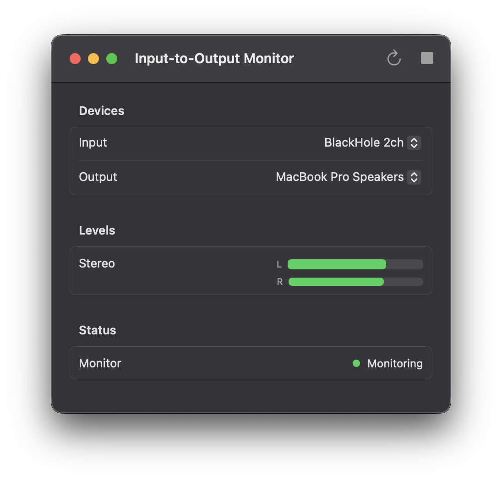

# Input-to-Output Monitor (macOS)

A native macOS audio routing window with two sections:

- **Interface → Interface:** save multiple input-to-output connections, each with its own switch.
- **App → Interface:** save routes from multiple applications to selected output devices and channels.

Connections, enabled/off state, and the selected section are saved in local app configuration (UserDefaults). Enabled routes resume on launch; unavailable applications or interfaces wait until they return. Switching an interface route off stops forwarding. Switching an app route off restores the application's normal audio output. Both keep their saved settings so they can be enabled again. New connections start off.

The two existing app bundles remain supported; both now show the same routing workspace. Each bundle uses its own configuration and privacy permissions.



## Run

From this directory:

```bash
swift run            # Input-to-Output Monitor
make run-router      # Application Audio Router (swift run Input-to-Output-Monitor --router)
```

Notes:
- You may need to grant microphone access to your terminal (System Settings -> Privacy & Security -> Microphone).
- Application routing requires macOS 14.2 or later and System Audio Recording permission. A packaged app receives the most reliable permission identity.
- Some device pairs may fail if the output device does not support the input device's sample rate and channel count.
- Application Audio Router keeps a list of **routes**. A route sends one application to one or two outputs of a device, for example Chrome to outputs 3–4 and Firefox to outputs 5–6 of BlackHole 16ch. Add one with **+** or ⌘N; double-click a route to edit it, press Delete to remove it, or use its switch to turn it off. Routes are saved, start when their application opens, and rebuild when it relaunches. An application can be in one route at a time; routes on the same outputs are mixed.
- Bluetooth, AirPlay, HDMI, and unusual multichannel layouts should be treated as experimental.

## App Bundle (Distribution)

Build both distributable `.app` bundles:

```bash
./Scripts/make-app-bundle.sh
```

The script builds one universal binary and packages it twice:
- `dist/Input-to-Output Monitor.app` (`com.mrk.inputtooutputmonitor`, asks for microphone access)
- `dist/Application Audio Router.app` (`com.mrk.applicationaudiorouter`, asks for System Audio Recording access)

Run them with:

```bash
open "dist/Input-to-Output Monitor.app"
open "dist/Application Audio Router.app"
```

## DMG Package (Unsigned)

Create a simple unsigned DMG containing both apps:

```bash
./Scripts/make-dmg.sh
open dist/InputToOutputMonitor.dmg
```

Notes:
- This DMG is unsigned and not notarized.
- On another Mac, users may need to right-click the app and choose **Open** the first time.

## App Icon

The bundler will include an icon automatically if you place:
- `Resources/AppIcon.icns`

Quick macOS-native workflow:
1. Create a square 1024x1024 PNG (e.g., headphones artwork).
2. Open it in Preview and export as multiple PNG sizes if desired.
3. Use `iconutil` with an iconset folder to produce `AppIcon.icns`, then place it at `Resources/AppIcon.icns`.
4. Rebuild the app bundle or DMG.

## Key files

- `Package.swift`
- `Sources/Input-to-Output-Monitor/InputToOutputDevices.swift`
- `Sources/Input-to-Output-Monitor/InputToOutputMonitorEngine.swift`
- `Sources/Input-to-Output-Monitor/AppAudioProcesses.swift`
- `Sources/Input-to-Output-Monitor/AppAudioRouterEngine.swift`
- `Sources/Input-to-Output-Monitor/AudioRoutes.swift`
- `Sources/Input-to-Output-Monitor/RoutesView.swift`
- `Sources/Input-to-Output-Monitor/ContentView.swift`
- `Sources/Input-to-Output-Monitor/InputToOutputMonitorApp.swift`
- `Scripts/make-app-bundle.sh`
- `Scripts/make-dmg.sh`
- `Resources/AppIcon.icns`

## Tests and continuous integration

Use full Xcode with Swift 6.2 or newer and SwiftLint 0.65.1:

```bash
make test   # hardware-free unit tests with coverage
make lint   # strict SwiftLint checks
make check  # lint, debug build, unit tests, release build
```

CI runs on pull requests and main/master pushes. Releases must pass the same
checks before building the DMG. Tests cover saved configuration and route
lifecycle using fake audio runtimes and isolated preferences. They do not replace
live audio verification. See [release checks](docs/RELEASE_CHECKS.md) for the
hardware checks and remaining release blockers.
